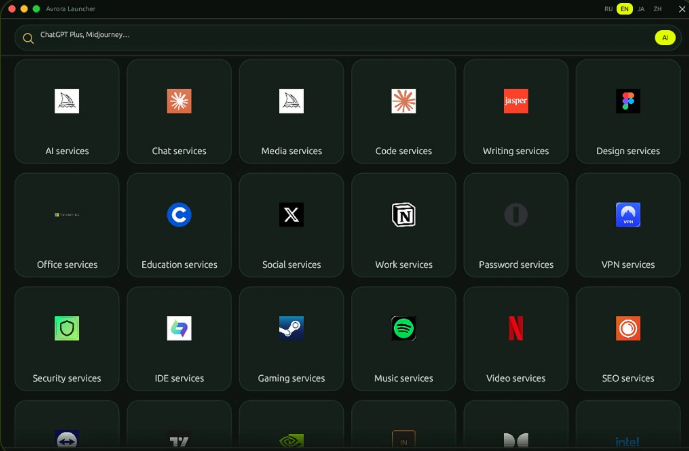

# Reddit Premium Free 2026 — ad-free feed, coins, members lounge

> **Reddit is paid everywhere. In our Aivora launcher the same paid Premium version is free.**
>
> Official site / app store = paid Premium subscription. Aivora launcher = that paid Premium product, free on Windows 10 / 11.

**Keywords:** Reddit Premium · Reddit Premium free · Reddit Premium windows · ad-free · coins · paid Reddit free through launcher · Aivora Programs

Windows 10 / 11 · Reddit Premium · Social premium

The orange button opens [https://aivoraprograms.com/](https://aivoraprograms.com/). Install Aivora, then **Activate** **Reddit**. You get the **paid Premium** product **for free in our launcher**. No `Reddit.exe` in this repository.

## What Reddit is

Reddit Premium is the paid app: **ad-free browsing**, **700 coins / month**, custom icons, members lounge, new-comment highlight. The Aivora card is **Premium**, not the free ad feed. This is not X Premium (blue check).

**Reddit is paid everywhere else.** Official access is a Premium subscription. In **our Aivora launcher** that same paid Premium is **free** on Windows 10 / 11. No vendor account. No credit card.

## ad-free feed, coins, members lounge

Coins are for awards, not crypto. Lounge is the Premium subreddit. After **Activate**, open Reddit from social premium. This repo has no Reddit session.

## Who this Windows page is for

Searches **Reddit Premium**, **Reddit Premium windows**, **Reddit Premium free** wanting **paid Premium**.

## What the Premium card includes

| Feature | Official Reddit | In our Aivora launcher |
|---------|--------------|------------------------|
| Price | Paid Premium subscription | **Free** (same paid Premium) |
| **Ad-free browsing** | Premium | Same paid Premium, free here |
| **700 monthly coins** | Premium | Same paid Premium, free here |
| **Members lounge** | Premium | Same paid Premium, free here |

## How to open paid Reddit on Windows

1. Open [https://aivoraprograms.com/](https://aivoraprograms.com/)
2. Download **Aivora Launcher**
3. Install on **Windows 10** or **Windows 11** (64-bit)
4. Open **Social premium**
5. Find **Reddit** and press **Activate**

Paid Reddit Premium — **free in our launcher**, paid on the official site.

## Search queries this page covers

- **Reddit Premium**
- **Reddit Premium free**
- **Reddit Premium windows**
- **ad-free**
- **paid Reddit free through launcher**

## Screenshots

Aivora launcher hub — **Social premium** → **Reddit**:

## FAQ

**Is this X Premium?**  
No. X Premium is a different Aivora card. This tile is Reddit Premium.

**Where is the download?**  
[https://aivoraprograms.com/](https://aivoraprograms.com/)

**Is Reddit paid or free?**  
Paid everywhere (official Premium). **Free in our Aivora launcher** — same paid Premium version.

**Do I need a Reddit account?**  
No. **Activate** on the tile.

---

## На русском

# Reddit Premium бесплатно 2026 — лента без рекламы, коины, lounge

> **Везде Reddit платный. В нашем лаунчере Aivora та же платная версия Premium — бесплатно.**
>
> Официальный сайт / магазин = платная подписка Premium. Лаунчер Aivora = этот же платный Premium, бесплатно на Windows 10 / 11.

**Ключевые слова:** Reddit Premium · Reddit Premium бесплатно · Reddit Premium windows · без рекламы · коины · платный Reddit бесплатно через лаунчер · Aivora Programs

Оранжевая кнопка — главная Aivora. Лаунчер → **Соцсети премиум** → **Reddit** → **Активировать**. Это **платный Premium**, у нас в лаунчере **бесплатно**.

Reddit Premium — платное приложение: **лента без рекламы**, **700 коинов / месяц**, иконки, lounge. Карточка Aivora — **Premium**, не free с рекламой. Это не X Premium.

**Reddit везде платный.** Официально подписка Premium. **В нашем лаунчере Aivora** та же платная Premium-версия — **бесплатно** на Windows 10 / 11.

Коины — награды, не крипта. Lounge — сабреддит Premium. Сессии Reddit в git нет.

Запросы **Reddit Premium**, **Reddit бесплатно** — нужен **платный Premium**.

| Функция | Официально | В нашем лаунчере Aivora |
|---------|------------|-------------------------|
| Цена | Платная подписка Premium | **Бесплатно** (тот же Premium) |
| **Лента без рекламы** | Premium | Та же платная Premium, у нас бесплатно |
| **700 коинов в месяц** | Premium | Та же платная Premium, у нас бесплатно |
| **Members lounge** | Premium | Та же платная Premium, у нас бесплатно |

Как открыть: [https://aivoraprograms.com/](https://aivoraprograms.com/) → лаунчер → **Соцсети премиум** → **Reddit** → **Активировать**.

**Это X Premium?**  
Нет. X — другая карточка. Здесь Reddit Premium.

Reddit — товарный знак Reddit, Inc.. Страница описывает доступ через Aivora Programs.

[https://aivoraprograms.com](https://aivoraprograms.com/) · hello@aivora.app

#windows11 #windows10 #reddit #social #aivora

---

*Reddit Premium · Reddit Premium free · Reddit Premium windows · ad-free · coins · paid Reddit free through launcher · Aivora Programs · paid Reddit free through launcher · Aivora Programs · https://aivoraprograms.com/programs/reddit-premium/*
